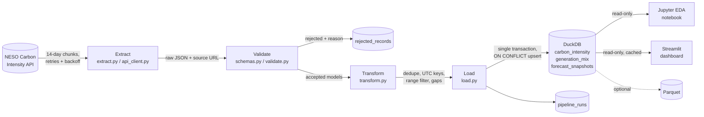

# GridGreen

**Carbon intelligence for a cleaner grid.**

GridGreen is an ETL + EDA project that answers one question:

> **When is Britain's electricity cleanest, and what makes it that way?**

It extracts half-hourly carbon-intensity and generation-mix data from the official NESO Carbon Intensity
API, validates every record with Pydantic, transforms it with pandas, stores it in DuckDB, analyses it in a
Jupyter notebook, and presents it in a seven-page Streamlit dashboard.

---

## Quick start (no commands needed)

Pick whichever suits you:

| | How | Needs |
|---|---|---|
| **Use the live dashboard** | Open the Streamlit Cloud link shared by the team | A browser |
| **Code in the browser** | On GitHub: **Code → Codespaces → Create codespace on main**. VS Code opens in the browser, installs everything, and opens the dashboard by itself. | A GitHub account |
| **Windows** | Double-click `run_windows.bat` | Internet on first run |
| **macOS / Linux** | Run `./run_mac_linux.sh` (or double-click it if your file manager allows) | Internet on first run |
| **VS Code (local)** | Open the folder. When VS Code asks to allow automatic tasks, choose **Allow**. Or use **Terminal → Run Task → GridGreen: Start dashboard**. | VS Code |

The launchers install `uv` and Python if needed, install dependencies, then update the data. If the NESO API is
unreachable they fall back to the **synthetic** demo database, which is clearly marked in the dashboard.
The first run takes a few minutes; later runs take seconds. Close the window, or press `Ctrl+C`, to stop.

---

## Contents
1. [Research questions](#research-questions)
2. [Data source and licence](#data-source-and-licence)
3. [Python version and dependencies](#python-version-and-dependencies)
4. [Architecture](#architecture)
5. [Validation rules](#validation-rules)
6. [Database schema](#database-schema)
7. [EDA methods](#eda-methods)
8. [Findings](#findings)
9. [Setup and usage](#setup-and-usage)
10. [Tests and CI](#tests-and-ci)
11. [Deployment](#deployment)
12. [Limitations and future work](#limitations-and-future-work)

---

## Research questions

| | Question | Where |
|---|---|---|
| A | What does a typical day's intensity pattern look like, and how variable is it? | Notebook §8, *Overview*, *Carbon Trends* |
| B | How does the pattern change by month and season? | Notebook §9, *Carbon Trends* |
| C | Which generation sources are associated with higher or lower intensity? | Notebook §10, *Generation Mix* |
| D | Do weekends differ from weekdays (hour-matched)? | Notebook §11, *Overview* |
| E | Which historical windows were cleanest for a flexible load of a given length? | Notebook §12, *Best Time to Use* |
| F | How accurate is the published forecast? | Notebook §13, *Forecast Analysis* |

Target users: people planning EV charging, heat-pump or other flexible demand, and anyone studying
power-sector emissions.

## Data source and licence

* **API:** NESO Carbon Intensity API for Great Britain, <https://carbon-intensity.github.io/api-definitions/>.
  No API key is required.
* **Endpoints used:**
  * `GET /intensity/{from}/{to}`: forecast, estimated actual and index per half-hour. The documented
    maximum range is **14 days**, so requests are split into 14-day chunks.
  * `GET /generation/{from}/{to}`: generation mix per half-hour. The same 14-day chunking is used.
  * `GET /intensity/{from}/fw48h`: the 48-hour forward forecast, stored as a snapshot on each run.
* **Licence:** [CC BY 4.0](https://creativecommons.org/licenses/by/4.0/), as stated in the API
  documentation. Attribution is shown in the dashboard footer.

Facts about the data that shape the analysis:

* **"Actual" is a NESO estimate**, derived from metered generation and modelled embedded wind and solar. It
  is not a direct measurement.
* **Generation is reported as percentage shares (`perc`), never MW.** GridGreen analyses shares and never
  infers absolute output or demand.
* **Historical intensity rows carry only the final forecast**, with no issue time, so forecast accuracy by
  lead time cannot be reconstructed from history. GridGreen therefore stores forecast snapshots going forward.

## Python version and dependencies

**Python 3.15.1**, the latest stable release on python.org (released 21 October 2026), was verified on
25 October 2026. The full stack installs from pre-built wheels. The test suite was also run on **Python
3.12.3** to support hosts without 3.15; `requires-python = ">=3.12"`.

| Package | Tested version | Role |
|---|---|---|
| pandas | 3.1.0 | Transformation and analysis |
| NumPy | 2.5.4 | Numerics |
| Pydantic | 2.14.1 | Record validation |
| DuckDB | 2.0.0 | Analytical database |
| PyArrow | 26.0.0 | Parquet export |
| httpx | 0.28.1 | HTTP client |
| Streamlit | 1.66.1 | Dashboard |
| Plotly | 7.1.0 | Charts |
| pytest / respx | 9.1.1 / 0.23.1 | Tests and HTTP mocking |
| Ruff | 0.17.2 | Lint and format |
| Jupyter / nbclient | 1.1.1 / 0.11.0 | Notebook |

Dependencies are managed with **uv**: `pyproject.toml` plus the `uv.lock` lockfile (129 packages).
`requirements.txt` is exported from the lockfile for hosts that need it.

Compatibility notes found during development:

* **DuckDB 2.0** keeps a partially fetched result open, and `register()` then fails. All reads therefore
  drain results with `fetchall()` (`database.scalar`).
* DuckDB needs `pytz` to return a `TIMESTAMPTZ` as a Python object, so the one scalar timestamp read uses
  `epoch_us()` instead of adding the dependency.
* pandas' `corr(method="spearman")` silently requires SciPy, so Spearman's ρ is computed from ranks
  (`analytics.spearman`).

## Architecture



```
gridgreen/
├── app.py                     Streamlit entry point (navigation, sidebar filters)
├── pages/                     The seven dashboard pages
├── src/gridgreen/
│   ├── config.py              Constants and every analytical definition
│   ├── api_client.py          HTTP client: timeouts, bounded retries, envelope checks
│   ├── extract.py             Chunked, failure-tolerant extraction
│   ├── schemas.py             Pydantic models
│   ├── validate.py            Validation with rejection auditing
│   ├── transform.py           pandas normalisation, dedupe, joins, features
│   ├── database.py            DuckDB schema and read helpers
│   ├── load.py                Transactional idempotent upserts, Parquet export
│   ├── pipeline.py            Orchestration and run logging
│   ├── analytics.py           Profiles, correlations, best-window search
│   ├── forecasting.py         MAE / RMSE / bias, snapshot alignment
│   ├── demo.py                SYNTHETIC data source for offline demos and tests
│   └── ui/                    Theme, charts, shared components
├── notebooks/gridgreen_eda.ipynb
├── scripts/                   run_pipeline.py, build_demo_db.py, build_notebook.py
├── tests/                     82 tests
└── .github/workflows/         ci.yml, refresh-data.yml
```

**Separation of concerns.** The dashboard opens DuckDB **read-only** and never runs ETL, so refreshing a
page cannot duplicate data. Data are cached per database file modification time, so a new pipeline run
appears on the next page load.

### Idempotency and restartability
* Primary keys: `carbon_intensity(interval_start_utc)` and `generation_mix(interval_start_utc, fuel)`.
* Loads use `INSERT … ON CONFLICT DO UPDATE`. `COALESCE` keeps an existing actual if a later payload omits
  it, and fills a missing actual once NESO publishes one.
* Each run is logged as `running` before work starts. All analytical writes happen in **one transaction**,
  so a crash leaves the previous state intact and the run is marked `failed` with the error.
* A failed 14-day chunk does not stop the others. The run is marked `partial` and lists the failed ranges.
  Re-running is always safe.
* **Incremental runs** resume from the last half-hour that has an estimated actual, so slots published
  later are refreshed.
* The pipeline refuses to write live API data into a database tagged as synthetic demo data, and vice versa.

## Validation rules

| Rule | Implementation |
|---|---|
| Required fields and types | Pydantic models `IntensityRecord`, `GenerationRecord` |
| Timezone-aware timestamps, converted to UTC | `AwareDatetime` + `to_aligned_utc` |
| Half-hour alignment (:00 or :30, zero seconds) | `schemas.to_aligned_utc` |
| Interval exactly 30 minutes | `_Interval._thirty_minutes` |
| Intensity within 0–1000 gCO₂/kWh (inclusive) | `Field(ge=0, le=1000)` plus a DuckDB `CHECK` constraint |
| A record needs a forecast or an actual | `IntensityRecord._has_a_value` |
| Index is a known NESO band | `IntensityValues._normalise_index` |
| Fuel shares within 0–100%, finite | `FuelShare` |
| No duplicate fuels within a half-hour | `GenerationRecord._complete_distribution` |
| Shares sum to 100 ± 1 pp | Same validator. Applied because the API presents a complete percentage distribution rounded to 0.1. |
| Unknown fuels | Kept, lower-cased, grouped as *other*, never discarded |
| Exact duplicate payloads | Counted, not re-validated |

Every rejected record is stored in `rejected_records` with a stable reason category, the full Pydantic
error list (JSON), the raw payload, the source URL, the first and last run IDs, and a sighting count.
Re-running does not duplicate rejections.

## Database schema

| Table | Key | Contents |
|---|---|---|
| `carbon_intensity` | `interval_start_utc` | `interval_end_utc`, `forecast`, `actual`, `intensity_index`, `source`, `run_id`, `loaded_at` |
| `generation_mix` | (`interval_start_utc`, `fuel`) | `perc`, `source`, `run_id`, `loaded_at` (long format) |
| `pipeline_runs` | `run_id` | status, range, request count, chunk failures, extracted/accepted/rejected/new counts per dataset, duplicates removed, missing intervals, message |
| `rejected_records` | `record_id` (hash of dataset + payload) | dataset, interval, reason, error details, raw payload, source URL, first/last run, times seen |
| `forecast_snapshots` | (`run_id`, `interval_start_utc`) | `retrieved_at`, `forecast`, `horizon_minutes` |
| `dataset_metadata` | `key` | `source` = `neso_api` or `synthetic_demo` |

### Analytical definitions
* **Time.** The key is the UTC half-hour start. UK local time (`Europe/London`) is derived for analysis only.
  A local day has **46** half-hours on the March change, **50** in October, and 48 otherwise.
* **Seasons** (meteorological): Winter = Dec–Feb, Spring = Mar–May, Summer = Jun–Aug, Autumn = Sep–Nov.
* **Zero-carbon** = hydro, nuclear, solar, wind. **Fossil** = coal, gas (and oil if ever reported).
  **Biomass** has a non-zero NESO emission factor and **imports** carry unknown foreign generation, so both
  are reported separately.
* **Forecast error** = forecast − actual. Positive bias means over-forecast.

## EDA methods

* Means **and** medians, with 10th–90th percentile bands, because averages hide day-to-day variation.
* Day × time-of-day "grid strip" heatmap of every half-hour, plus month × hour heatmaps.
* Seasonal box plots with sample sizes, and a warning when the period is too short for trend claims.
* Pearson and Spearman correlation of each fuel share with intensity, scatterplots with least-squares lines,
  and intensity by zero-carbon share band. These are explicitly treated as associations: shares are
  compositional, and NESO derives intensity from the mix.
* **Hour-matched** weekday/weekend comparison (weekend 14:00 vs weekday 14:00), so differences in missing
  data across hours cannot bias it.
* **Best window** (`analytics.best_windows`):
  1. Values are placed on the complete UTC half-hour grid.
  2. Each candidate window of k = duration/30 slots is averaged. Slots are equal length, so this equals the
     duration-weighted mean.
  3. Windows below a coverage threshold (default 100%) are rejected.
  4. The best window is compared with the **random-start baseline**, the mean of all valid windows.
  5. A non-overlapping top-N list and a typical-start-time profile are also reported.
* **Forecast evaluation:** MAE, RMSE, bias, median and 95th-percentile absolute error, sample count, error
  distribution and error by hour. Horizon metrics come from `forecast_snapshots` aligned to the *target* half-hour.

## Findings

**Not yet populated with real results.** The development environment could not reach the NESO API, so no
real data has been collected. The notebook generates its findings text from whatever database it reads.
To produce them:

```bash
uv run python scripts/run_pipeline.py --start 2025-10-01 --end 2026-10-01
uv run jupyter lab notebooks/gridgreen_eda.ipynb
```

Then replace this section with the findings from notebook §14, written in your own words. Do **not** copy
numbers from the synthetic demo database: they come from a toy generator and say nothing about the grid.

## Setup and usage

### Install
```bash
# Install uv: https://docs.astral.sh/uv/
uv python install 3.15
uv sync                      # creates .venv from uv.lock, including dev tools
```
Without uv: `python3.15 -m venv .venv && source .venv/bin/activate && pip install -r requirements.txt && pip install -e .`

### Run the ETL pipeline
```bash
uv run python scripts/run_pipeline.py --start 2025-10-01 --end 2026-10-01   # initial backfill
uv run python scripts/run_pipeline.py                                       # incremental update
uv run python scripts/run_pipeline.py --export-parquet                      # also write data/parquet/
```
The script prints a JSON run summary. Exit codes: `0` success, `2` partial (some chunks failed; re-run),
`1` failure. A one-year backfill is about 54 API requests.

### Run the notebook
```bash
uv run jupyter lab notebooks/gridgreen_eda.ipynb
# or headless:
uv run jupyter nbconvert --to notebook --execute notebooks/gridgreen_eda.ipynb --output gridgreen_eda_executed.ipynb
```
Set `GRIDGREEN_DB_PATH` to analyse a different database file.

### Run the dashboard
```bash
uv run streamlit run app.py
```
The app reads `GRIDGREEN_DB_PATH` if set. Otherwise it uses `data/gridgreen.duckdb`, then falls back to the
synthetic demo database with a permanent warning banner, then to an empty state with instructions.

### Offline demo (synthetic data)
```bash
uv run python scripts/build_demo_db.py
GRIDGREEN_DB_PATH=data/demo/gridgreen_demo.duckdb uv run streamlit run app.py
```
This runs the **real** validate → transform → load code on generated, API-shaped JSON, including
deliberately invalid records, so the rejection path is exercised. It is for demonstrating the software only.

## Tests and CI

```bash
uv run pytest -q             # 82 tests
uv run ruff check . && uv run ruff format --check .
```

| File | Covers |
|---|---|
| `test_api_client.py` | Retries with exponential backoff, `Retry-After`, timeouts, non-retryable 4xx, bad envelopes, chunking, partial chunk failure |
| `test_validation.py` | Valid and invalid models, range bounds, alignment, naive timestamps, missing fields, share tolerance, duplicate fuels, rejection auditing |
| `test_transform.py` | 46/48/50-slot DST days, UTC→UK conversion, repeated October hour, deterministic dedupe, missing intervals, joins, empty inputs |
| `test_database.py` | Idempotent upserts, `COALESCE` behaviour, rollback, `CHECK` constraints, full-pipeline idempotency, incremental resume, source mixing guard, failed-run logging, Parquet round trip |
| `test_analytics.py` | Best-window maths, coverage, gaps, non-overlap, DST windows, invalid durations, day-type comparison, Spearman without SciPy |
| `test_forecasting.py` | MAE / RMSE / bias values and sign, unpaired rows, snapshot alignment to target time, horizon buckets |
| `test_sample_fixtures.py` | Hand-written API fixtures through extract → validate → transform |
| `test_dashboard.py` | Headless render of all seven pages, filter changes, reset, missing-database state |

The dashboard was additionally checked in headless Chromium: all pages render without exceptions, controls
change results, and there is no horizontal overflow at a 390 px mobile width.

**GitHub Actions** (`.github/workflows/ci.yml`) runs on push and pull request, with read-only permissions.
It installs the locked dependencies on Python 3.15 and 3.12, runs Ruff lint and format checks and pytest,
and on 3.15 also executes the notebook against synthetic data as a smoke test. Any failing step fails the
job. The workflow file was syntax-checked but has **not yet run on GitHub**. For extra supply-chain
hardening, pin the two actions to full commit SHAs.

## Deployment

**Target: Streamlit Community Cloud.** The platform's filesystem is not persistent, so the dashboard never
writes to the database:

1. Run the pipeline locally and commit `data/gridgreen.duckdb`. It is opened read-only, and a year is a few MB.
2. Push to GitHub, then create an app at <https://share.streamlit.io> with main file `app.py`.
3. In *Advanced settings*, choose Python 3.15 if offered. Otherwise choose the newest available version
   ≥ 3.12, which is the tested minimum.
4. Dependencies install from `requirements.txt`. `app.py` adds `src/` to the import path, so the package
   does not need installing.

To keep data fresh, `.github/workflows/refresh-data.yml` runs the pipeline and commits the updated database.
It is manual by default; the schedule is commented out because every run adds a binary file to git history.
Scheduled runs also accumulate the forecast snapshots needed for horizon analysis. For a larger project,
move the snapshot to object storage (or Parquet on S3) instead of git.

Deployment to Streamlit Cloud has **not** been performed or verified from the development environment.

## Interface

* **Light and dark mode.** A toggle in the sidebar switches every colour for the current browser session:
  page CSS, Plotly templates, the Overview component, the replay heatmap and the illustrations. Both palettes
  live in `src/gridgreen/ui/theme.py`, and tests check every text colour pair in both against WCAG contrast.
  Streamlit's own data tables keep Streamlit's style (it offers no API to restyle them from code).
* **Colour-blind friendly scale.** Intensity runs from blue (clean) to coral (carbon-intensive).
* **Animated page overviews** (`ui/banners.py`): one small, theme-aware SVG scene per page. All motion stops
  when the viewer's system asks to reduce motion.
* **"A day on the grid"** (Overview): a continuously looping illustration in which 24 hours pass in about
  24 seconds. The colour of the energy flowing through the power lines is the period's real average intensity
  for that time of day. It has a pause button and stops for viewers who prefer reduced motion.

## Third-party assets

The interactive Overview ("Grid Pulse", `src/gridgreen/ui/pulse/`) is a Streamlit custom component built with
**Apache ECharts 6.1.0**, vendored as `echarts.min.js` so the app does not depend on a CDN at runtime.

* Licence: Apache-2.0 (`src/gridgreen/ui/pulse/ECHARTS_LICENSE.txt`).
* Source: npm `echarts@6.1.0`. Its npm integrity hash was verified on download.
* SHA-256 of the vendored file: `b66b25aeb4df84e33199dc21694014d336d222cbd9deb0e5a7c14bd6aa0d0fd0`.
* All numbers it displays are computed in Python (`ui/pulse.py`) by the shared analytics functions; the
  browser code only draws them.

## Limitations and future work

* No real data has been collected yet (see [Findings](#findings)).
* "Actual" is a modelled estimate, and generation is shares only, so demand and absolute output cannot
  be analysed.
* Results are national. Regional intensity (`/regional/...`) can differ greatly and would be a natural
  extension.
* Correlation is not causation, and compositional shares are not independent variables.
* One year cannot separate seasonal effects from that year's weather. Multi-year backfills would help.
* The normal-approximation confidence intervals ignore autocorrelation and are too narrow. A block
  bootstrap would be more honest.
* Forecast-horizon analysis depends on snapshots accumulated from now on.
* Future work: regional analysis, block-bootstrap uncertainty, weather covariates (wind speed, solar
  irradiance), and a forward-looking recommender built on the live 48-hour forecast, clearly separated
  from the historical analysis.

---
Data: NESO Carbon Intensity API, licensed CC BY 4.0.
